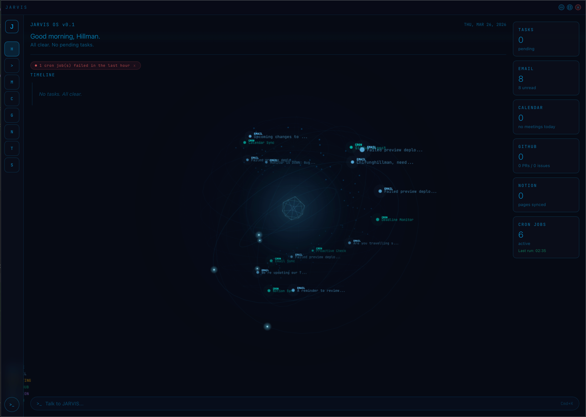

# JARVIS -- AI-Powered Command Center for macOS

> One voice. Five tools. Zero context switching.

A native macOS AI assistant that turns email chaos into calendar action. Say "Hey JARVIS" -- it scans your inbox, surfaces urgent items, drafts replies, blocks calendar time, and syncs across Notion, GitHub, and Obsidian. One command. No tab switches.

Built with **Tauri v2** (Rust) + **React** + **TypeScript**. No Electron. No web server. Just Rust and a webview.

**Hillman Chan** | Founder & AI Engineer | [hillmanchan.com](https://hillmanchan.com) | [jarvis-automation.com](https://jarvis-automation.com)

[The Problem](#the-problem) | [Solution](#solution) | [Features](#features) | [Tech Stack](#tech-stack) | [Getting Started](#getting-started) | [Architecture](#architecture) | [Business](#business) | [Roadmap](#roadmap)

---

> **HKSTP Ideation Programme** | Cohort AWS26-04 | Jun 2026 -- May 2027
> Supported by **AWS Activate** (US$25K credits) and **HKSTP** (HK$100K grant pathway)

---

## The Problem

Knowledge workers run their day across a handful of tools that do not talk to
each other. Reading an email, deciding what it means, and turning it into a
calendar entry or a task is manual work repeated dozens of times a day.

Existing AI tools are siloed: Notion AI stays in Notion, Copilot stays in code, Siri does not execute SaaS workflows. Nobody connects them.

## Solution

JARVIS sits on your desktop and connects everything. It syncs your email, calendar, notes, and code in the background, surfaces what matters through an AI-curated timeline, and lets you interact via voice or chat.

**Speak or type** -> **JARVIS routes & executes** -> **Unified response**

Example: *"Summarise unread emails, add urgent ones to Notion, block 2pm tomorrow."*

JARVIS picks the right tools (Gmail, Notion, Calendar), chains the actions, and returns one clear result. Local actions are near-instant. Background jobs (daily briefs, email triage) run unattended.

### Why JARVIS is Different

| | JARVIS | OpenClaw | ChatGPT | Claude |
|--|--------|----------|---------|--------|
| Target user | Indie devs & solo founders on macOS | Open-source devs | General consumers | Knowledge workers |
| Cross-tool depth | 5+ native macOS integrations | DIY plugins | Limited connectors | Computer Use (beta) |
| Setup | Voice-first, one-click install | Self-host manually | Browser-based | Manual prompts |
| Data storage | **Local SQLite, no JARVIS server** | Self-host | Cloud | Cloud |
| Inference | Cloud by default, local via Ollama opt-in | Self-host | Cloud | Cloud |
| Pricing | Freemium -> HK$148/mo | Free / OSS | US$20/mo | US$20/mo |

**Different layers of the stack.** Use OpenClaw for coding. Use JARVIS for everything else.

---

## Screenshot



*Dashboard: 3D data sphere with live email/cron/calendar nodes, sidebar navigation, AI-curated timeline, real-time stats panel. Full holographic theme with cyan glow accents.*

---

## Features

### Interactive 3D Data Sphere

Real-time holographic sphere rendered with **Canvas2D** (no Three.js, no WebGL). Visualizes your actual data as color-coded nodes orbiting a glowing core:

- **Cyan** = tasks | **Light blue** = emails | **Amber** = calendar | **Green** = GitHub | **Purple** = Notion | **Teal** = cron

Mouse-drag rotation, click-to-zoom, idle auto-rotation. Voice activity modulates ring speed and color intensity. Data refreshes every 10 seconds.

### AI Chat with Tool Execution

- **Cmd+K** opens floating chat panel
- Dual-model: Claude (primary) + OpenAI fallback
- Streaming responses with real-time token display
- **18 native tools** the AI can call: open apps, run commands, manage files, create tasks, search email, compose messages, query calendar, control system
- Conversation history persisted in local SQLite

### Voice I/O

- **Cmd+Shift+J** for push-to-talk
- Speech-to-text: OpenAI Whisper API (cloud) + local Whisper model (offline)
- Text-to-speech: macOS `say` with configurable voice, rate, volume
- Visual indicator: cyan (listening), amber (processing), green (speaking)
- Mic amplitude drives 3D sphere animations

### Integrations

| Service | What JARVIS Does | Sync |
|---------|-----------------|------|
| **Gmail** | Inbox sync, summaries, smart archive with learning | Every 5 min |
| **Google Calendar** | Event sync (7-day horizon), meeting prep alerts | Every 5 min |
| **Notion** | Page search, content snippets, create new pages | Every 10 min |
| **GitHub** | Assigned issues, PRs for review, CI status | Every 10 min |
| **Obsidian** | Vault search, read/write notes via Local REST API | On demand |

### Smart Assistant

- **Morning briefing** on launch using aggregated context
- **Email learning** tracks archive patterns -- auto-suggests rules after 3 archives from same sender
- **Context builder** gathers tasks, deadlines, unread counts, PRs into one AI snapshot
- **Action parser** intercepts AI responses and executes commands

### Automation Engine

- **7 built-in cron jobs**: email sync, calendar sync, deadline monitor (daily 9 AM), Notion sync, GitHub digest, email auto-archive, proactive alerts
- **Custom cron jobs** via natural language -- AI generates the cron schedule
- Full execution history with status tracking

### System Control

The AI can execute directly on your Mac: open apps/URLs, run shell commands (with safety blocklist), search files, read/write clipboard, manage windows, control volume/brightness/dark mode, send notifications, take screenshots.

---

## Tech Stack

| Layer | Technology | Why |
|-------|-----------|-----|
| **Desktop** | [Tauri v2](https://v2.tauri.app/) | Native binary ~10MB. Rust backend + webview. Not Electron. |
| **Backend** | Rust | Memory-safe, fast, async (tokio). All API calls, auth, scheduling, voice, system control. |
| **Frontend** | React 18 + TypeScript + Vite | Minimal deps. No UI library. Just React hooks and custom CSS. |
| **3D** | Canvas2D | Custom math for 3D projection. No Three.js needed. |
| **Database** | SQLite (rusqlite + refinery) | Local-first. 11 tables, 6 migrations. All data on your machine. |
| **AI (primary)** | Claude API | Streaming SSE, native tool calling, multi-step iterations. |
| **AI (fallback)** | OpenAI API | Same 18 tools via function calling. Auto fallback. |
| **Voice STT** | Whisper API + local whisper-rs | Cloud primary, offline fallback. |
| **Voice TTS** | macOS `say` | Zero-dependency TTS. |
| **Auth** | OAuth2 PKCE | Google sign-in. Tokens in SQLite, auto-refresh. |
| **Scheduling** | tokio-cron-scheduler | Background cron on tokio runtime, persisted across restarts. |

### Why These Choices

**Tauri over Electron:** ~10MB native binary vs ~200MB Electron. Rust handles CPU-intensive work (audio, local inference, concurrent APIs) without blocking UI.

**Local storage, cloud inference (current state):** Conversations, tasks and
synced context live in SQLite on the device and never reach a JARVIS server.
Inference is a different matter and the distinction is worth stating plainly:
the default provider chain is cloud Gemini (`src-tauri/src/lib.rs`), so message
and email content is sent to Google's API. Local inference through Ollama is
supported and opt-in via Settings, not the default. Do not describe JARVIS as
"local-first inference" until the default chain resolves to a local endpoint.

**Canvas2D over Three.js:** Simpler, no dependencies, performs well for this scale. One React component, one `<canvas>`.

**No UI library:** Custom holographic CSS. Component libraries would fight the design.

---

## Architecture

```
+--------------------------------------------------+
|                    macOS App                       |
|                                                    |
|  +--------------------+  +---------------------+  |
|  |   React Frontend   |  |    Rust Backend      |  |
|  |                    |  |                       |  |
|  |  3D Data Sphere    |  |  AI Router            |  |
|  |  Chat Panel        |  |    Claude + OpenAI    |  |
|  |  Dashboard         |  |    18 callable tools  |  |
|  |  Pages (7)         |  |                       |  |
|  |  Voice Indicator   |  |  Integrations         |  |
|  |                    |  |    Gmail, Calendar    |  |
|  |  Hooks             |  |    Notion, GitHub     |  |
|  |    useChat         |  |    Obsidian           |  |
|  |    useVoiceState   |  |                       |  |
|  |    useKeyboard     |  |  Voice Engine         |  |
|  |                    |  |    Whisper STT        |  |
|  +--------+-----------+  |    macOS TTS          |  |
|           |              |    Audio Capture       |  |
|     Tauri invoke()       |                       |  |
|           |              |  Scheduler             |  |
|           +--------------+    7 cron jobs         |  |
|                          |                       |  |
|                          |  System Control        |  |
|                          |    Apps, URLs, shell   |  |
|                          |    Files, clipboard    |  |
|                          |    Windows, volume     |  |
|                          |                       |  |
|                          |  SQLite (11 tables)    |  |
|                          +---------------------+  |
+--------------------------------------------------+
```

### AWS Cloud Architecture (Scaling Phase)

```
+-------------------+     +--------------------+
|   JARVIS macOS    |---->|  AWS Cognito       |  Auth + user accounts
|   (Local-first)   |     +--------------------+
|                   |---->|  AWS S3 + KMS      |  Encrypted sync (opt-in)
|  80% local AI     |     +--------------------+
|  20% cloud AI     |---->|  AWS Bedrock       |  Heavy inference (opt-in)
|                   |     +--------------------+
|                   |---->|  AWS Lambda         |  Webhooks + background
+-------------------+     +--------------------+
```

---

## Business

### Market Opportunity

| Segment | Size | Basis |
|---------|------|-------|
| **TAM** -- Global productivity AI | ~US$36B by 2033 | Grand View 2025, CAGR 15.9% |
| **SAM** -- English-speaking macOS pros | ~US$400M | ~1.8M reachable workers x US$228/yr |
| **SOM** -- HK/GBA beachhead (3 years) | HK$0.5--1.4M ARR | 300-800 paying users x HK$148/mo |

### Pricing

| Tier | Price | What You Get |
|------|-------|-------------|
| **Free** | $0 | Gmail + Calendar, 20 AI chats/day |
| **Pro** | HK$148/mo (~US$19) | All 5 integrations, unlimited voice, automation, wake word |
| **Team** | HK$298/seat/mo (~US$39) | Pro + shared workspace, admin controls, RBAC, team digest |

> Pricing is not live. Stripe is in test mode and the app does not yet
> enforce tier limits, so the table above describes the intended plans, not
> what is currently sold.

### Programme Support

| Programme | Value | Status |
|-----------|-------|--------|
| **HKSTP Ideation** | HK$100K grant (Silver + Gold + Platinum badges) | Accepted, Jun 2026 |
| **HKSTP Incubation** (next phase) | Up to HK$1.29M | Target May 2027 |
| **AWS Activate** | US$25K credits | Approved |

---

## Roadmap

Full detailed roadmap: [`docs/business/BUSINESS_ROADMAP.md`](docs/business/BUSINESS_ROADMAP.md)

| Quarter | Theme | Key Milestones |
|---------|-------|---------------|
| **Q1** Jun--Aug 2026 | Silver Badge + Foundation | AWS control plane, v0.2 beta, 30 customer interviews, 50-person waitlist, HKSTP license signed |
| **Q2** Sep--Nov 2026 | Gold Badge + Market Validation | v1.0 closed beta (50 users), HK incorporation, pricing validation, pitch video, market report |
| **Q3** Dec 2026--Feb 2027 | Open Beta + Soft Launch | Plugin SDK, 100 active users, Product Hunt launch (Jan), paid conversion testing |
| **Q4** Mar--May 2027 | Platinum Badge + Scale | Pro tier launch, 100+ paying users, HK$10--18K MRR, PRD, Incubation Panel |

### North Star

**100+ paying users / HK$10--18K MRR by May 2027**

---

## Getting Started

### Prerequisites

- **macOS** (uses native APIs: `say`, `mdfind`, `open`, accessibility)
- Xcode Command Line Tools -- `xcode-select --install`
- [Rust](https://rustup.rs/) 1.70+
- [Node.js](https://nodejs.org/) 18+
- [cmake](https://cmake.org/) -- `brew install cmake` (required for whisper-rs)

### Install

```bash
git clone https://github.com/ChiFungHillmanChan/jarvis-ai-assistant.git
cd jarvis-ai-assistant
npm install
```

### Configure

```bash
cp .env.example .env
```

Add your API keys:

```env
ANTHROPIC_API_KEY=sk-ant-...    # Claude API (primary AI)
OPENAI_API_KEY=sk-...            # OpenAI (fallback AI + Whisper STT)
GEMINI_API_KEY=...               # Gemini provider chain option
AWS_ACCESS_KEY_ID=...            # Amazon Bedrock fallback provider
AWS_SECRET_ACCESS_KEY=...
AWS_BEDROCK_REGION=us-east-1
AWS_BEDROCK_MODEL_ID=anthropic.claude-sonnet-4-6
GOOGLE_CLIENT_ID=...             # Gmail + Calendar OAuth (optional)
GOOGLE_CLIENT_SECRET=...         # Gmail + Calendar OAuth (optional)
```

**Minimum requirement:** At least one AI provider configured in Settings. JARVIS supports local endpoints, Gemini, Claude, OpenAI, and Amazon Bedrock in a priority chain.

### Google OAuth Setup

1. [Google Cloud Console](https://console.cloud.google.com) -- create project, enable Gmail + Calendar APIs
2. Configure OAuth consent, create Desktop app credentials
3. Add your email as test user
4. Put Client ID and Secret in `.env`

### Run

```bash
npm run tauri dev
```

First build compiles ~530 Rust crates (several minutes). Subsequent builds are incremental.

---

## Keyboard Shortcuts

| Action | Shortcut |
|--------|----------|
| Open chat | **Cmd+K** |
| Close chat | **Esc** |
| Push-to-talk | **Cmd+Shift+J** |

---

## Design

Full holographic theme, pure CSS -- no UI component library.

- **Background:** #060a14 (near-black with blue undertone)
- **Accent:** rgba(0, 180, 255) (glowing cyan)
- **Panels:** Glassmorphism with backdrop-filter blur, cyan border glow on hover
- **Typography:** JetBrains Mono (system labels), Inter (body text)
- **No emojis** -- text and geometric elements only

---

## Local Whisper Model (Optional)

For offline speech-to-text fallback:

```bash
mkdir -p ~/Library/Application\ Support/jarvis/models
curl -L https://huggingface.co/ggerganov/whisper.cpp/resolve/main/ggml-base.bin \
  -o ~/Library/Application\ Support/jarvis/models/ggml-base.bin
```

---

## Development

| Command | Purpose |
|---------|---------|
| `npm run tauri dev` | Full app (Vite + Rust backend) |
| `npm run dev` | Frontend-only dev server (port 1420) |
| `npm run build` | TypeScript check + Vite production build |
| `npm run tauri build` | Desktop release build |
| `cargo test --manifest-path src-tauri/Cargo.toml` | Rust tests |

### Commits

Follow Conventional Commits: `feat(scope): message`, `fix(scope): message`, `refactor:`, etc.

---

## How It Was Built

Built iteratively with [Claude Code](https://claude.ai/code). Workflow: design specs -> Tauri scaffold -> Rust modules one integration at a time -> AI layer -> voice pipeline -> 3D sphere -> smart features -> scheduler.

Key tools: [Tauri v2](https://v2.tauri.app/), [Claude Code](https://claude.ai/code), [Anthropic Claude API](https://docs.anthropic.com/), [OpenAI API](https://platform.openai.com/), [rusqlite](https://github.com/rusqlite/rusqlite), [tokio-cron-scheduler](https://github.com/mvniekerk/tokio-cron-scheduler), [cpal](https://github.com/RustAudio/cpal), [whisper-rs](https://github.com/tazz4843/whisper-rs).

---

## Coming Next

- **Plugin SDK** -- let users add their own SaaS integrations
- **End-to-end encrypted sync** -- cross-device with zero-knowledge encryption
- **Team tier** -- RBAC, admin controls, audit logs for B2B
- **Model routing** -- smart routing between local/cheap/expensive models for cost efficiency
- **Cantonese voice support** -- via AWS Transcribe + Polly

See [`docs/business/BUSINESS_ROADMAP.md`](docs/business/BUSINESS_ROADMAP.md) for the full quarterly breakdown.

---

## License

MIT

---

*Built in Hong Kong. Scaling on AWS.*
